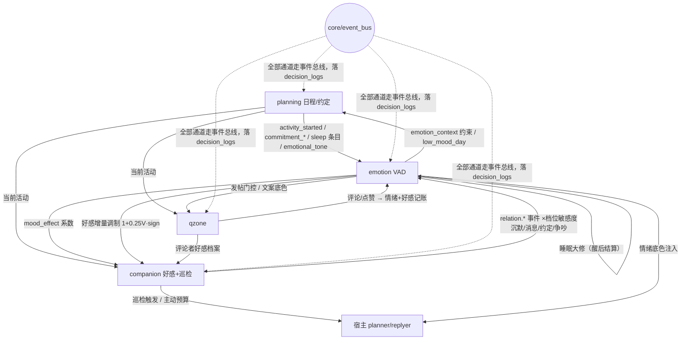

> ⚠️ **【已废弃 · 只读留档】本文件是 v1.2 原文快照，不是现行计划书。**
> **请改用 [MAINTENANCE_PLAN_10.25.md](MAINTENANCE_PLAN_10.25.md)（唯一现行版）。**
> 本文件不再更新：里程碑勾选、M0 整改复验口径（§9.1）、完工评估与清退清单、工作报告规范一律以 10.25 版为准。
> 保留本文件的唯一用途 = 追溯被清退的"多用户好感度"设计沿革（10.25 版已将该内容清退出正文，仅归档于其 §10.1）。

# 猫眼生活套件（cateye_test）长期演进计划书（v1.2 原文快照 · 已废弃）

> 版本：v1.2（2026-10-03 第二次修订：⑥按用户裁决收窄清理清单并新增裁决记录——保留恋人电脑屏幕感知、planning 早间问好（群聊）与 patrol 早安（目标私聊）职责不同并存、UPLOAD_AGENT.md（发布必要约束，改代码无需阅读）、字体资源与 PIL 渲染链；⑦新增聚合状态指令里程碑 M7。此前 v1.1：①好感度裁撤多用户，改单用户 + 工具传参识别；②关系→情绪敏感度由乘算改加算并新增全局倍率；③新增 v1.3.0 开发文档可行性核对（§6.5）；④"重置"语义修正为**代码结构重置**（§八.6）；⑤不做项归档（§九））｜适用插件版本：v0.4.0+
> 性质：**活文档**。本文档供后续 agent 会话长期执行"重置 / 更新 / 维护"使用。
> 与既有文档的关系：README.md = 功能清单（跟随实现更新）；USAGE.md = 命令与工具；
> SYNERGY.md = 联动愿景初稿；**本文档 = 总纲**，吸收并取代 SYNERGY.md §5 的分期路线图
> （P1~P5 → 本文 M0~M6），SYNERGY §2~§4 的联动点详设继续有效并细化进 §四~§六，
> 冲突处以本文档为准。

---

## 〇、如何使用本文档（给未来 agent 的操作规程）

1. **接手时**：先读 §一（要做成什么样）和 §二（现在是什么样），再读本次任务对应的里程碑（§七）。
2. **实现某里程碑时**：严格按该里程碑指向的 §三~§六 设计节落码；改动文件清单和验收标准以 §七 为准。
3. **完成一期后**：
   - 跑 `scratch/smoke_test_cateye_test.py`（40 组件 + 配置模型 + 能力核对）与
     `scratch/behavior_test_cateye_test.py`（核心算法回归），**新增算法必须配新用例**；随后按
     [TEST_PROCEDURE.md](TEST_PROCEDURE.md) 的 SOP 做宿主级验证（L1 热重载 + L2 注入场景）；
   - 在 §七 路线图表格中勾选状态；
   - 同步 README.md 功能清单 / USAGE.md 命令变化 / 模块内 INTEGRATION.md；
   - `_manifest.json` 的 `version` 按里程碑递增（M0~M2 → 0.3.x，M3~M5 → 0.4.x，M6 → 0.5.0，M7 → 0.6.0）。
4. **"重置"= 代码结构与功能的重置**（精简臃肿、去冗余），不是清数据：移除/合并候选清单见 [CLEANUP_PROPOSALS.md](CLEANUP_PROPOSALS.md)（用户勾选后执行），执行规程见 §八.6。
5. 铁律：**任何跨模块影响都不得绕过 §六.3 的非决定性七原则**；发现既有实现违反时，修复优先于新功能。

---

## 一、拟人化目标行为目录（联动最终要达成什么）

一切设计以这张表验收——每一条"像人"的行为都能指到支撑它的联动通道与里程碑。

| # | 目标行为（观察者视角） | 支撑机制 | 涉及模块 | 里程碑 |
|---|---|---|---|---|
| B1 | 重要的人一天没理 bot，bot 会**闷闷不乐但不当场崩溃**：私聊时语气淡一点，群里照常聊得开心 | 沉默事件（小幅 ΔVAD）+ 加性叠加 + 指数衰减 + 睡眠收敛 | companion→emotion | M3 |
| B2 | bot 心情好时更容易被取悦，心情差时对同样的话好感加得少（情绪染色记忆） | 情绪效价调制好感度增量 | emotion→companion | M3 |
| B3 | 每天聊天有来有回，好感**缓慢爬升**；几周不说话，好感**慢慢降温**但底色（关系基线）还在 | 规则事件累计 + 日衰减向基线回归 + 基线慢速漂移 | companion 内部 | M1 |
| B4 | 想念的频率随亲密度变化：越亲密越快"想TA了"，且情绪低落时更想找重要的人 | miss 阈值 × 档位系数 × 情绪系数 | companion+emotion | M1/M4 |
| B5 | 约好了晚上一起打游戏，兑现后明显开心、好感+1；放了鸽子则低落 | planning 约定机制 → 双系统事件 | planning→emotion/companion | M3 |
| B6 | 考试周睡醒会带着焦虑醒（日程"明日预期"渗入睡眠结算），连续低迷时日程自动安排放松活动 | 睡眠大修 v2（前日残差/明日预期）+ 连续低迷软约束 | planning↔emotion | M5 |
| B7 | 情绪低落时不硬营业：不发说说或减少主动开口；兴奋时分享欲上升 | 情绪 → patrol 概率乘数 / qzone 发帖门控 | emotion→companion/qzone | M4 |
| B8 | 空间说说随当日情绪定调；被点赞评论会高兴一下 | qzone 文案拼情绪 + 互动正事件 | qzone↔emotion | M4 |
| B9 | ~~对陌生评论者礼貌、对熟络的人随意（多用户好感档案）~~ **已裁撤**（§九.1）；回评语气差异改由宿主 PersonInfo 印象承担 | —（不做项） | — | 归档 |
| B10 | 关系有"回忆"：注入里能引用最近几天的相处印象（"TA 最近项目忙"），而不是只有干巴巴的档位 | 关系日结裁判生成滚动印象 | companion 内部 | M2 |
| B11 | 一天内主动打扰总量有节制：私聊主动 + 空间互动提醒共享预算，不会轰炸 | 全渠道打扰预算 | 全模块 | M0 |
| B12 | 跨夜情绪是"睡出来的"：入睡冻结、醒来结算，睡得好恢复多、日程高压恢复少 | 睡眠结算改造 + 恢复系数 | emotion+planning | M5 |
| B13 | 一条聚合指令看全部：日程/好感/情绪/空间状态渲染成一张状态图（内置字体） | 新 Command + PIL 内置字体渲染（planning/assets） | 全模块 | M7 |

---

## 二、现状盘点（截至 2026-10-03；2026-10-04 终态刷新见 §2.3）

### 2.1 模块与关键挂点索引

> 行号引用为 v0.2.0 快照，重构后以符号名为准。详细模块内部结构见各 `INTEGRATION.md` 与 Explore 摘要（本文只列联动相关面）。

| 模块 | 职责 | 对外可消费 | 关键挂点 |
|---|---|---|---|
| planning/ | 日程生成（LLM 多轮+评分）、SQLite 持久化、planner/replyer 注入、活动切换主动开口、约定（pending_commitment） | `ScheduleQuery`（find_current_activity / format_day_summary）、`get_current_activity` API（planning/components.py:151）、`GoalManager.add/consume_pending_commitments`（goal_manager.py:325/367） | 注入文本拼接 inject_service.py:588-649（:617-628 `state_hint` 静态模板）；日程生成上下文 schedule_generator.py:340-385 → prompt_builder.py:329-433；主动触发 proactive_service.py:42-66（频率因子/模板）、:717-731（proactive.trigger） |
| companion/ | 好感度（3 档静态）、巡检判定链（早安/晚安/想念/节点/日常）、习惯记忆、关系预设（恋人/挚友/维护者/家人）、屏幕感知、消息服务 | `AffectionManager`（affection.py:28）、`PatrolService.patrol_status`（patrol.py:149）、`patrol.last_user_msg_time` 经 affection、`MessageService` | 巡检判定链 patrol.py:214-453（想念 :348-398）；触发统一入口 `_trigger_planner` patrol.py:486-508；注入好感后缀 components.py:457-495；replyer 补计 Hook components.py:366-401 |
| emotion/ | VAD 状态机（25 原型映射、指数衰减、偏移/乘数）、回复后增量评估、睡眠裁判大修、情绪底色注入 | `EmotionService.mood_text()/injection_text()`（service.py:67-77）、`EmotionStateMachine.record_event/apply_sleep_overhaul/effective_vad`（state_machine.py:117/149/136） | 评估入口 evaluate_reply（service.py:100-119，由 replyer.after_response 触发，components.py:153-172）；睡眠循环 service.py:195-231；注入 Hook components.py:125-147 |
| qzone/ | 按日程发说说（双通道）、自动回评（CGI 楼中楼）、评论基线提醒 | `QzoneService.generate_and_post_by_schedule / reply_comments / poll_comments / posts_today`（service.py:308/343/431/302） | 发帖门控 `_tick`（service.py:545-561）；回评 LLM prompt（QZONE_REPLY_PROMPT，:380-392）；评论者印象 `_get_impression`（:421-429，读宿主 PersonInfo） |
| core/ | LLMService（generate/judge/generate_or_fallback，llm_utils.py:45/150/190）、DecisionLogger/LLMCallLogger（diag.py:105/195）、load_json/save_json_atomic（storage.py）、时间/注入工具 | 全模块共用 | 联动事件若落 decision_logs 用 `record(action=..., trigger_type=..., reason=..., **fields)`（diag.py:142） |

组合根：plugin.py 装配顺序 :53-78，生命周期 :97-167；所有服务束运行时动态读 `plugin.config.*`（热重载生效），跨模块互访靠 `plugin._planning / _companion / _qzone / _emotion / _affection / _schedule_query / _llm / _decision_logger` 直接引用。

### 2.2 联动现状与空白点

已实现（详见 SYNERGY.md §1）：planning→companion（当前活动）、planning→qzone（当前活动+文案）、planning→emotion（sleep 条目触发大修、前后日日程作裁判输入）、emotion→宿主（replyer/planner 情绪底色注入）。

空白点（按影响排序）：

1. **companion→emotion 完全断开**：目标用户的沉默、主动、约定、争吵等关系事件不产生任何情绪增量——B1 无法发生。
2. **emotion→companion / emotion→planning / emotion→qzone 全部断开**：情绪只是"注入的形容词"，不调制任何行为概率与好感变化——B2/B7/B8 无法发生。
3. **好感度是"设定值"不是"系统"**：3 档整数只有两条修改途径（配置 `current_level` 热重载同步 companion/services.py:138；LLM 手动调 Tool 直接设档 companion/components.py:622-630 与命令 :745），无事件、无累计、无衰减、无周期、无 LLM 参与。
4. **qzone 互动无下游**：评论/点赞不进入情绪与好感记账（qzone 只单向展示 affection 状态，qzone/components.py:129-138）。
5. **模块互访靠直接引用**，新增联动会持续加深耦合、难以观测因果链。
6. 情绪评估事件源单一：只有"bot 自己回复后"的评估（evaluate_reply），看不到用户说了什么；沉默等"零消息事件"没有入口。

### 2.3 终态刷新（2026-10-04：版本、组件面与宿主验证结论）

> 本节为 2026-10-04 终局一致性刷新（一次性终态）；§2.1/§2.2 的 10-03 快照原样保留。

- **版本与组件面**：插件版本 **v0.4.0**（M0~M4 全部落地，`_manifest.json version=0.4.0`）。`cateye_test` 组件 **40**（10 HookHandler + 14 Tool + 12 Command + 4 API，smoke test 断言 40）；测试辅助插件 `cateye_harness` **11**（9 Command + 1 Hook 环路守卫 + 1 注入网关）。
- **宿主验证日（10-03/10-04）六场景 L2 全部执行**：bus_check=PASS（M0）；affection_basic + v1 迁移=PASS（M1）；attribution=PASS（M3，复验后）；mood_effect=PASS（M4，复验后）；silence=PASS（M3；≥4h 间隔断言并入明日 L5）；affection_review=PASS（M2，复验后）。另 **qzone 子项=PASS**（status/post/文案情绪行；接线修复 `bdf29e6` 后实测，双通道完整态见顺延项）。
- **宿主验证日累计发现并修复 7 项缺陷（一句话 + commit）**：
  1. 插件目录不在宿主 sys.path（插件顶层导入被宿主 `src/` 抢占或找不到）→ 两插件 `plugin.py` 顶部 sys.path 引导头（`91251a9`/`8176d19`）；
  2. `schedule_query` 缓存窗口 15h 过长 → 15min（`5008cf1`）；
  3. P1 EmotionServices 委托缺失（情绪 Hook AttributeError ×44）→ 扩展委托（`e993e9f`；P1~P4 全部修复见 `29bf06f`）；
  4. P2 `is_notify` 注入被整体忽略 → 修复（`29bf06f`）；
  5. P3 睡眠裁判 `max_tokens` 截断 → 提升预算（`29bf06f`）；思考型模型仍会挤爆预算致空正文，裁判任务必须绑真非思考模型（§八.8）；
  6. P4 日结失败也落 date → 改为成功才落 `reviewed_date`（`29bf06f`）；
  7. QzoneService config 接线错位（8 处 `self._config.qzone` 落空）→ 实参修正 + `_qzone_cfg()` 活取值器（`bdf29e6`）。
- **仍顺延项与去向**：silence ≥4h 间隔断言 → 明日 L5 判定；qzone 自动回评/评论提醒链路 → 留观或小号配合；工具 `is_target` 子项 → deferred 池发现性裁决（M5 挂账）；qzone 双通道完整态（cookie/动作通道连通）→ 环境就绪后复验。
- **emotion 已初始化**：bot 回执 + `params.initialized=true`，锚点 V=0.25/A=−0.35/D=−0.15。
- **一致性门标记**：交接确定性门对 MAINTENANCE_PLAN 的核对标记词「迷迭香」（机器核对用文档指纹，无业务含义）。

---

## 三、联动基础设施：进程内事件总线（里程碑 M0）

**动机**：§五~§六 的联动矩阵有 20+ 条通道，继续点对点引用会失控。加一个 ~120 行的轻量总线，联动变成"发布/订阅"，全部事件自动落 decision_logs 可回放调参。

### 3.1 API（新增 `core/event_bus.py`）

```python
class EventBus:
    def subscribe(self, event: str, handler: Callable[[dict], Awaitable[None]], *,
                  owner: str = "") -> Callable[[], None]   # 返回反订阅闭包
    async def publish(self, event: str, **payload) -> int  # 逐个 await，异常隔离并记日志
    def publish_soon(self, event: str, **payload) -> None  # create_task 包装（Hook 内用）
```

约定：

- 事件名 `模块.事件`（snake_case）；payload 首字段统一 `ts`（ISO 时间）与 `source`（发布方模块名）；
- 发布方只放 **ID 与摘要**（qq、stream_id、delta、事件名），订阅方需要更多数据时自己拉（保持单向依赖，发布方不知道订阅方存在）；
- 每 publish 自动 `DecisionLogger.record(action=f"bus:{event}", **payload 摘要)`（决策日志开关关闭时零开销）；
- 深度保护：订阅器内再 publish 同一事件的递归深度 ≤5，超过丢弃并告警；
- 订阅注册/注销挂在各服务束 `start()/stop()`（plugin.py:156-167 已有装配点）。

### 3.2 标准事件表（首批，附录 A 为完整版）

| 事件 | 发布方 | 订阅方 |
|---|---|---|
| `schedule.generated` | planning 自动生成/重生成后 | emotion（缓存明日情感预期）、qzone |
| `schedule.activity_started` / `activity_ended` | planning ProactiveService 活动切换判定处 | companion（主动开口）、qzone（类型白名单）、emotion（可选） |
| `schedule.sleep_started` / `woke_up` | emotion 睡眠循环 | emotion（M5 冻结/结算）、planning |
| `schedule.commitment_kept` / `commitment_broken` | planning GoalManager 约定消费/到期 | emotion、companion（好感规则事件） |
| `relation.message_received` / `relation.silence_detected` / `relation.interaction_event` | companion | emotion（×敏感度）、companion 好感记账 |
| `relation.affection_tier_changed` / `relation.daily_reviewed` | companion 好感层 | 注入/日志/命令播报 |
| `emotion.updated` / `emotion.overhauled` / `emotion.low_mood_day` | emotion | planning（次日日程）、qzone（门控）、日志 |
| `qzone.posted` / `qzone.comment_received` / `qzone.comment_replied` | qzone | emotion（互动情绪）、companion（评论者好感） |
| `proactive.used` | 一切主动行为通道（patrol / planning proactive / qzone 提醒） | core 预算计数器（B11） |

---

## 四、情绪系统评估与改进

### 4.1 现状评估

**做对了的（保持不动）**：
- 开环控制正确：LLM 只输出"事件→增量"（referee.py:180-192 `evaluate_reply_delta`），状态机在代码里维护绝对值（state_machine.py），LLM 永远看不到绝对 VAD（防讨好/漂移）；
- 数值卫生完备：每步 `_clip`（±0.5 评估限幅）、指数衰减向锚点回归（`apply_daily_decay`，state_machine.py:104-115）、静态偏移只在 `effective_vad()` 结算不重复累加、睡眠大修"锚点 + 残差×恢复系数 + 裁判增量"（:149-175）、裁判返回代码层二次限幅；
- 25 原型加权距离映射 + 低分辨率描述给 LLM 反馈（vad.py:133-182），模糊化防表达脱节；
- 请求失败静默降级、状态 JSON 原子落盘、参数由人设一次性推导（referee.py:144-177）。

**不足（按优先级）**：
1. **事件源单一**：只有 replyer.after_response 一个入口（components.py:153-172）。用户的沉默、约定兑现、空间互动、日程高压全部无入口 → 情绪只反映"bot 说了什么"，不反映"发生了什么"。
2. **评估上下文缺失**：评估 prompt 只给 bot 的回复文本，事件描述常是"日常对话"；应补上用户侧最后一两条消息。
3. **情绪不驱动行为**：`mood_text()` 只被注入使用，patrol 概率、qzone 门控、日程生成都不消费——"情绪低落时少营业"（B7）做不到。
4. **睡眠结算时点不对**：大修在入睡瞬间应用（service.py:162-193），当天深夜事件无处安放；应冻结→醒后结算（B12，SYNERGY §2 已规划）。
5. **planner 通道注入未融合**：planning 的注入（inject_service.py:617-628）里 `state_hint` 是静态模板库，与 emotion 底色注入并存但互不知情，两套"精神状态"可能互相矛盾。

### 4.2 改进方案

| 改进 | 设计 | 落点 | 里程碑 |
|---|---|---|---|
| 统一外部事件入口 | `EmotionService.record_external_event(source, description, delta=None, *, use_llm=False, multiplier=1.0)`：有模板 delta 直接 `record_event`（×multiplier），无则走 `evaluate_reply_delta`；全程节流与限幅不变 | emotion/service.py 新增；emotion/bridge.py（新）订阅 §3.2 事件 | M3 |
| target 识别 + 加算倍率 | 私聊按聊天流 QQ；群聊由 bot 工具 `cateye_test_emotion_report(event, is_target)` 声明（非法值静默忽视）；factor = `global_event_multiplier × (1+加成(tier))` 或 `× non_target_multiplier`（§6.2 A） | emotion/bridge.py、emotion/components.py（新 Tool） | M3 |
| 沉默事件（B1 核心） | companion 巡检在 `last_user_msg_time` 超过 miss_hours_min 时发布 `relation.silence_detected`（每日 ≤2 次、间隔 ≥4h）；emotion 侧按模板 ΔV=−0.12×(1+加成)、ΔA=+0.04×(1+加成) 记账（零 LLM 成本；加成见 §5.3 加算表） | patrol.py:348-398 判定段发布；emotion/bridge.py 消费 | M3 |
| 评估上下文增强 | evaluate_reply 的 prompt 追加"用户侧最后一条消息"（经 `ctx.message.get_by_time_in_chat` 反查该流最近消息，拿不到就跳过），事件描述要求概括"这轮交流发生了什么" | emotion/service.py:100-119、referee.py EVALUATE_PROMPT | M3 |
| 情绪行为化输出 | `EmotionService.mood_effect() -> dict`：返回结构化系数 `{"proactive_rate": 0.8~1.2, "miss_threshold": 0.7~1.1, "post_rate": 0~1.2, "intent_hint": "..."}`，纯规则计算零成本；默认映射见附录 C | emotion/service.py；消费方见 §六.2 E/F | M4 |
| 睡眠结算改造（B12） | 进入 sleep 条目 → 冻结（事件照常入队、暂停衰减与评估结算）；大修计算完成并缓存；`woke_up` 事件到达（当前活动离开 sleep）→ 应用缓存并解冻 | emotion/service.py、state_machine.py | M5 |
| 睡眠大修 v2 | 输入增加：前日日程情感残差 R_yesterday、明日预期 E_tomorrow（来自日程条目 `emotional_tone` 字段）、当日约定兑现情况；限幅从固定 ±0.8 改为 ±(0.4+0.4×schedule_emotion_weight)；恢复系数恒 ≥0.3 保证收敛 | referee.py、state_machine.py、planning/generator/schema_builder.py+validator.py | M5 |
| planner 注入融合 | planning `_render_unified_prompt` 的精神状态行改为读 `mood_text()`（替换静态 `generate_emotion_text`），避免与 emotion 注入条目矛盾 | planning/inject_service.py:617-628、inject/state_analyzer.py:262 | M4 |
| 连续低迷软约束 | 连续 3 天日均线 V<−0.5 → 发布 `emotion.low_mood_day`；planning 生成次日日程时强制插入一次 social/rest 并在 prompt 注明"最近有点低落"（防彻底抑郁，原设计文档 §十二.3） | emotion/service.py 日统计；prompt_builder | M5 |

---

## 五、好感度系统重设计（核心章节，仿情绪系统架构）

### 5.1 现状评估：为什么必须重做

当前 `AffectionManager`（companion/affection.py:28-172）的全部"好感"内容 = 一个 0/1/2 整数 + 每日计数器 + 早晚安/想念标记 + habits 字典。`today_speak_count` 只是巡检预算计数器，与好感无关。

具体缺陷：

1. **无量纲**：3 档不可微调。"今天聊得特别投缘"和"今天一句没说"对好感度的影响完全相同；档位跳变没有过程、没有解释、没有记忆。
2. **无生命周期**：不衰减、不演化——升到 2 档后哪怕一个月不说话仍是"热恋"。
3. **无 LLM 参与**：唯一的"智能"是 LLM Tool 直接 set 档位（等价于改配置），没有"事件→变化"的评估，模型既看不到自己的行为对关系的影响，也无法积累关系叙事。
4. **仅单用户**：整个档案绑定 `target_qq` 一人；群聊成员、空间评论者无档案（qzone 回评只能用宿主 PersonInfo 印象）。多用户扩展经评估**不做**（§九.1），本条仅为现状描述。
5. **与情绪零交互**：B2（情绪染色好感）无从谈起。
6. **消费面窄**：档位只影响称谓/后缀/小剧场/注入描述（relation.py 预设），不影响巡检频率、想念阈值等实际行为。

### 5.2 设计原则：镜像情绪系统的三层架构

情绪系统能稳定运行的原因 = **LLM 只做有界判断、代码持有状态、大小周期分工**。好感度系统照搬同一套骨架：

| 层 | 情绪系统（现有） | 好感度系统（新） |
|---|---|---|
| 状态层（代码） | VAD 原始值 + 锚点/偏移/乘数 | `score`（0~100 连续分）+ `baseline`（关系基线，慢速移动的锚点）+ 档位映射（迟滞） |
| 事件层（LLM 有界判断） | 事件 → ΔVAD ±0.5（小模型） | 事件 → Δscore（规则表先行，LLM 裁判处理低频高权重事件）± 有界 |
| 小周期（代码） | 每小时指数衰减 exp(−0.08·Δt) | 每日衰减：score += (baseline − score) × 0.06 |
| 大周期（LLM 裁判） | 睡眠裁判：日志+日程 → ΔVAD ±0.8 + 锚点收敛 | 关系日结裁判：当日事件+互动统计 → Δscore ±2 + 滚动印象 + 周结大事记 |
| 防漂移 | LLM 看不到绝对 VAD，只有低分辨率描述 | LLM 看不到绝对分值，只有档位描述与"近期关系温度" |

关键差异说明：情绪的锚点是人设推导后**固定**的；好感度若用固定锚点则关系永远冻结，所以用 **baseline 慢速 EMA** 代替锚点——score 是"近期相处感受"（波动层），baseline 是"感情底色"（漂移层）。这正对应人对关系的直觉：闹几天别扭不伤感情底色，长期冷淡才会。

### 5.3 状态层设计

```jsonc
// affection_memory.json v2（兼容读取 v1；单用户档案，只服务 target_qq 一人）
{
  "version": 2,
  "score": 55.0,            // 0~100，初始 30
  "baseline": 30.0,         // 关系基线（慢速移动的锚点），初始与 score 相同
  "tier": 2,                // 当前档位（含迟滞后的生效值）
  "tier_entered_at": "...", // 迟滞用：进入当前档位的时间
  "daily_delta": {"date": "2026-10-03", "positive": 0.0, "negative": 0.0},
  "event_log": [            // 当日事件（供日结裁判），结构与 EmotionEvent 类似
    {"ts": "...", "kind": "chat_round", "desc": "...", "delta": 0.05}
  ],
  "impressions": [          // 滚动印象（日结裁判产出），保留 10 条、7 天过期
    {"date": "2026-10-02", "text": "今天TA提到项目要上线，最近很忙"}
  ],
  "milestones": [],         // 周结大事记（可选，M6）
  "last_user_msg_time": "...", "last_speak_time": "...",   // v1 字段原地保留
  "habits": {},             // v1 habits 原地保留（memory_manager 不动）
  // v1 一日标记原样平铺（巡检预算逻辑不变）
  "today_speak_count": 0.0, "today_date": "...",
  "morning_sent_today": false, "night_sent_today": false, "miss_sent_today": false
}
```

**v1 → v2 迁移**（无感、一次性、启动时执行）：读到 `"version"` 缺失且存在 `affection_level` 时，`score = {0:25, 1:55, 2:80}[level]`、`baseline = score`、`tier = level`，其余 v1 字段（habits/一日标记/时间戳）平铺保留；写回即升级。迁移失败（JSON 损坏）按全新档案处理并告警。

**档位映射（恋人预设，5 档；其余关系预设标签见附录 B，relation.py 扩表）**：

| 档 | 名称 | 分数区间 | 情绪加成（**加算**，默认 = target_bonus_step × (档+1)） |
|---|---|---|---|
| 0 | 生疏 | [0, 20) | +0.1 |
| 1 | 熟悉 | [20, 45) | +0.2 |
| 2 | 亲密 | [45, 70) | +0.3 |
| 3 | 热恋 | [70, 88) | +0.4 |
| 4 | 挚爱 | [88, 100] | +0.5 |

**迟滞（防档位震荡）**：升档需 `score ≥ 上界 + 3`，降档需 `score ≤ 下界 − 3`，且距 `tier_entered_at` ≥ 24h；不满足时保持原档并记日志。v1 的 3 档对外展示可通过档位组合兼容（0/1→旧0，2/3→旧1，4→旧2）以便 Tool/命令过渡期不炸。

**单一档案与 target 识别（v1.1 修订；多用户裁撤理由与备选方案见 §九.1）**：档案只服务 `target_qq` 一人，情绪事件归属判定分两条路：

- **私聊**：聊天流 QQ == target_qq → target 事件。自动评估路径（`maisaka.replyer.after_response` payload 自带 `session_id`，v1.3.0 §9.6 ✔）与目标私聊 stream_id 比对即可；
- **群聊**：bot 调用情绪上报工具 `cateye_test_emotion_report(event, is_target)` 时**传参声明**"这件事是否由那个重要的人引发"。该参数**永不拒绝**：缺失、类型不对、胡填一律静默忽视（按非 target 计），代码不报错、最多 debug 级日志；⚠️ Tool 默认进 deferred 工具池（未设 `core_tool=True`），bot 自发调用不保证（触发条件必须写进 detailed_description，陷阱 #22），replyer 自动评估路径始终是主通道，工具只是补充；
- 工具上报处理（v1.3.0 §7.1 ✔）：event 文本走小模型 `evaluate_reply_delta` 出有界 ΔVAD，按 §6.2 A 的加算倍率入账。

### 5.4 事件层：规则事件表 + LLM 裁判

**规则事件（零 LLM 成本，先行落地 M1）**——所有事件统一走 `AffectionState.record_rule_event(kind, delta, desc, *, caps)`，自动套日累计上限与情绪调制（§六.2 B）：

| kind | delta | 频控 |
|---|---|---|
| `chat_round`（与 target 一问一答） | +0.05 | 日累计 ≤ +1.0（防刷分；消息轰炸无效） |
| `user_initiated`（bot 沉默 ≥1h 后对方先开口） | +0.15 | 日 ≤ +0.5 |
| `morning_exchange` / `night_exchange`（互道早晚安） | +0.2 | 各 1 次/日 |
| `commitment_kept`（planning 约定兑现，订阅事件） | +1.0 | 每约定 1 次 |
| `commitment_broken`（约定违约） | −0.5 | 每约定 1 次 |
| `qzone_comment` / `qzone_like`（他人评论/点赞，M6） | +0.15 / +0.05 | 日 ≤ +0.5 |
| `silence_day`（整日无消息） | 不即时扣分；作为日结裁判输入与情绪沉默事件的依据 | 1 次/日 |
| `conflict` / `apology_accepted`（LLM 裁判标记） | −1.5 / +1.0 | 即时 |

现有 `increment_speak()` 的全部调用点（patrol.py:206/505、message_service.py:64、components.py:394/601）**语义保持"预算计数"不变**，不混入好感分；好感记账走独立入口，避免预算逻辑与关系逻辑互相污染。

**LLM 裁判（`companion/affection_referee.py`，新文件，镜像 emotion/referee.py 结构）**：

1. **会话采样裁判** `evaluate_conversation_delta()`：每 20 轮对话或每日 ≤2 次触发（配置 `affection.review_sample_every_rounds / review_max_per_day`）；输入 = 最近 ~10 条对话摘要 + 双方称呼与人设 + **关系档位描述（不给分数）** + 当前情绪低分辨率描述（让裁判知道"bot 今天心情一般"）；输出 JSON：`{"event": "≤30字", "delta": x ∈ [-2, +2.5], "tag": "normal|conflict|apology|sweet"}`。prompt 明确：**阿谀奉承、无意义刷屏不给正分；真诚的关心、共同完成一件事、化解矛盾才给**。代码层 `_clip` 后 ×情绪调制系数入账。
2. **关系日结裁判（大周期）** `run_daily_review()`：睡眠时段执行（订阅 `schedule.sleep_started`，晚于情绪睡眠大修，避免抢 LLM 并发）；输入 = 当日事件日志 + 互动统计（消息轮数/谁主动/沉默时长）+ 最近印象 + 档位描述 + 人设；输出 JSON：`{"delta_score": x ∈ [-2, +2], "impressions": ["...", ...]（0~3 条带日期）, "tone": "一句话概括今日关系温度", "reason": "引用原文"}`。代码应用 delta → 追加 impressions（滚动 10 条/7 天过期）→ 清空当日 event_log。
3. **周结（M6，可选）**：每周日日结时把 7 天 tone/delta 汇总 → 生成 1~2 条 milestones（"这周一起熬过了考试周"），供注入与周年式事件使用。

LLM 调用全部经 `core/llm_utils.LLMService`（generate 带 `event="affection_review"` 等；判别类走 `judge()` + 顶层 `[judge]` 段参数），失败静默跳过、下轮重试——与 emotion 的失败哲学一致。

### 5.5 周期层（代码）

- **日衰减（小周期）**：日切时（patrol `_tick` 的日切分支 patrol.py:223-225 处发布/调用）`score += (baseline − score) × 0.06`；随后 `baseline += (score − baseline) × 0.03`。效果：一次 +2 的甜蜜日 5~6 天后回落大半，但 baseline 已悄悄上移——好感"涨得慢、忘得慢"。
- **日累计限幅**：positive ≤ +4 / negative ≥ −3（含规则事件与裁判），超出部分记日志丢弃。
- **档位重估**：每次 score 变动后跑迟滞判定（§5.3），档位变化发布 `relation.affection_tier_changed`（旧档/新档/原因），companion 注入与 patrol 行为随之切换。

### 5.6 消费端

1. **注入**：现有好感后缀通道（components.py:457-495 拼 `level_description`）改为读新档位描述 + **最近 1~2 条印象 + tone**；`build_personal_context()` 继续提供 habits。
2. **Tool/命令**：`cateye_test_mai_lover_affection` 语义从"直接设档"改为"移动 score 到该档区间中值并重估档位"（保留管理员兜底能力）；`/cateye_test_mai_affection` 输出 score/baseline/档位/今日 Δ/最近印象。
3. **patrol 行为差异化（M1 起）**：miss 阈值区间 `miss_hours_min/max` × 档位系数（附录 B：生疏 1.4 → 挚爱 0.6，越亲密越快想念）；`daily_max_speak` 可选按档位 ±1（配置关闭默认不动）。
4. **qzone 回评**：语气不做分档（多用户档案已裁撤，§九.1）；`_get_impression`（qzone/service.py:421-429）维持宿主 PersonInfo 印象。

### 5.7 新增配置（`[affection]` 段扩展，全部带默认值可关闭）

`enabled`(bool, 默认 true——false 时退回 v1 三档行为)、`decay_pull`(0.06)、`baseline_ema`(0.03)、`daily_positive_cap`(4.0)、`daily_negative_cap`(3.0)、`review_sample_every_rounds`(20)、`review_max_per_day`(2)、`review_enabled`(true)、`review_task_name`(默认 "utils")、`tier_hysteresis`(3.0)、`tier_min_dwell_hours`(24)、`emotion_modulation`(true, 情绪调制开关)。字段样板（label/i18n/hint）照抄 companion/config.py 现有风格。

情绪侧（`[emotion]` 段）同步新增三项倍率配置（详见附录 C）：`global_event_multiplier`(1.0, 0.1~3.0, 全局情绪幅度)、`non_target_multiplier`(1.0, 0~1, 非 target 事件系数)、`target_bonus_step`(0.1, 0~1, 每档加成步长)。倍率配置一律用标量不用 dict/list（dict 字段 WebUI 显示 `[object Object]`，陷阱 #4）。

---

## 六、模块相互影响深度分析（联动矩阵）

### 6.1 总图（目标态）



### 6.2 通道详表（每条含幅度控制）

**A. 关系 → 情绪：target 识别 + 加算倍率**（实现 B1；v1.1 修订）

- **识别**：私聊按聊天流 QQ 判定（自动评估路径 after_response 带 session_id，v1.3.0 §9.6 ✔）；群聊由 bot 经 `cateye_test_emotion_report(event, is_target)` 传参声明，非法值静默忽视按非 target 计（§5.3）。
- **倍率（加算，非乘算）**：`final_delta = delta × global_event_multiplier × K`，其中
  - target 事件：`K = 1 + 情绪加成(tier)`（+0.1~+0.5，§5.3 表）；
  - 非 target 事件：`K = non_target_multiplier`（默认 1.0，可配 ≤1，如 0.8 淡化群聊影响）。
  - 设计理由：旧方案的乘算 0.4 会把非目标人群的存在几乎从情绪世界抹掉——群里别人的话毫无情绪反馈，不像人；加算让所有人保持自然幅度 1.0，重要的人只是"额外放大一档"。`global_event_multiplier`（默认 1.0，0.1~3.0）是总幅度旋钮，作用在**一切**情绪事件增量上（不含衰减），运行期即可调控 bot 情绪整体波动大小。
- 沉默事件模板：ΔV=−0.12、ΔA=+0.04，按上式乘 K（轻度不安而非悲伤）；**频控每日 ≤2 次、间隔 ≥4h、仅 target**。
- 幅度控制：单事件经 record_event 的 ±0.5 限幅、0.08/h 指数衰减、睡眠大修收敛——三重收敛下，连续多日被无视最多把当日 V 压到 −0.3 附近，且第二天睡眠后基本归锚点。

**B. 情绪 → 好感度增量**（实现 B2）

- 公式：`delta_affection_final = delta × clamp(1 + 0.25 × V_current × sign(delta), 0.6, 1.4)`。
- 心理学含义：情绪-一致性偏差——开心时好事加分更多（V=+0.6 → 正事件 ×1.15、负事件 ×0.85 更宽容）；低落时坏事扣分更狠、好事打折（V=−0.6 → 正事件 ×0.85、负事件 ×1.15 更易怒）。乘数对称保正负同时缩放，不会出现"心情差所以骂人也不扣分"。
- 配置开关 `affection.emotion_modulation`；情绪模块关闭时乘数恒 1。

**C. 情绪 → companion 行为**（实现 B7 前半、B4 后半）

- patrol `_tick` 在概率掷骰前读 `mood_effect()`：`activity_trigger_rate/default_speak_rate × proactive_rate`；miss 随机阈值采样后再 × `miss_threshold`（低落 → 阈值×0.8 更快想念重要的人；兴奋 → ×1.1 不急着打扰，自己在玩）。映射表见附录 C，全部乘数限制在 [0.7, 1.3]（post_rate 允许 0）。
- proactive intent 文本追加 `intent_hint`（如"你今天有点低落，语气可以软一点"），经现有 `_trigger_planner` 的 reason 拼接，零新 Hook。

**D. 情绪 → qzone**（实现 B7 后半、B8）

- `_tick` 发帖判定（qzone/service.py:545-561）：`post_rate × mood_effect.post_rate`；`V < −0.6` 且 `qzone.emotion_filter`（默认 true）→ 本轮跳过发帖（低落不硬营业）。
- 文案：`generate_moment_text` / `QZONE_REPLY_PROMPT` 拼 `mood_text()`（service.py:324-340、:380-392 两个 prompt 各加一行）。

**E. planning → 情绪**（实现 B5、B6 前半）

- 约定兑现/违约 → `schedule.commitment_kept/broken` → 好感规则事件（+1.0/−0.5）+ 情绪模板事件（ΔV +0.2/−0.15）。
- 日程条目增加可选 `emotional_tone`（schema_builder 校验落 parameters，裁剪 ±0.5）：M5 前仅作睡眠裁判文本参考；M5 起进入 R_yesterday/E_tomorrow 数值项与动态限幅（SYNERGY §3.1 公式原样采用）。
- 高压日程（连续 ≥4h study/work）在 `activity_started` 事件里带 `stress=true`，emotion 侧可选记 ΔA+0.05（默认关，防止日程刷情绪）。

**F. 情绪 → planning**（实现 B6 后半）

- `woke_up` 应用大修后发布 `emotion.overhauled`（含低分辨率 VAD）；planning 在 auto_generate 时把"睡醒情绪描述 + 引导约束"拼进 `emotion_context` 槽（prompt_builder.py:329-433），强度 `schedule.emotion_influence`(0~1，默认 0.6)；已生成当天日程则只在重生成时生效。
- `emotion.low_mood_day` → 次日生成强制插入一次 social/rest（连续低迷软约束，§4.2）。

**G. qzone ↔ emotion**（实现 B8；B9 已归档 §九.1）

- `qzone.comment_received`（payload：内容摘要、是否楼中楼）→ emotion 正事件（ΔV+0.05~+0.1，被在乎的感觉，走全局倍率）；**不**为评论者建立好感档案（§九.1），回评语气维持宿主 PersonInfo 印象。

**H. 全渠道打扰预算**（实现 B11）

- 一切主动行为（patrol 五类触发、planning proactive/morning、qzone 新评论提醒）触发成功前发 `proactive.used`；core 内存计数（按日），各发布方触发前查询"今日全渠道主动数 ≤ `patrol.daily_max_speak + 2`"（可配 `patrol.global_proactive_cap`）。实现为 event_bus 上的一个内置订阅器 + 查询函数，不新建文件也行（放 core/event_bus.py 内）。

### 6.3 非决定性七原则（所有联动通道的验收铁律）

用户核心关切："重要的人没理 bot，情绪稍微低下但**不决定性**——bot 在群里聊得开心就不受太大影响"。为此规定：

1. **跨模块影响一律是增量**，任何模块不得直接设置另一模块的绝对状态（仅有的两个例外：睡眠大修与关系日结，且它们本身有界并向锚点/基线收敛）。
2. **所有增量在代码层硬限幅**（评估 ±0.5、沉默 −0.12×敏感度、日结 ±2、好感日累计 +4/−3），LLM 输出超界一律裁剪。
3. **所有状态有回归**：情绪 → 锚点（衰减 + 睡眠收敛系数恒 ≥0.3）；好感 → baseline（日衰减 6% + baseline EMA）。
4. **加性叠加**：情绪是全部事件增量之和，任何单事件对当日总波动的占比 ≤20%（用 behavior test 回放校验）。
5. **负向日累计下限**：情绪单日累计 ΔV ≥ −0.4、好感日累计 ≥ −3——"一个人冷落"永远不可能单日把 bot 推进抑郁或仇视。
6. **LLM 隔离**：裁判类请求看不到任何绝对值（只给低分辨率描述/档位描述），杜绝"模型看着 −0.9 往 −1.0 说"的漂移；模型换人换脾气不影响系统单调性。
7. **全程可观测**：所有跨模块事件与最终增量落 decision_logs（含 multiplier 与裁剪前后值），`/cateye_test_life diag` 可查因果链，可离线回放调参。

### 6.4 场景数值推演（设计自检）

**场景 1（= 用户原例）**：恋人（热恋，加算加成 +0.4 → 系数 1.4）早上 9 点后没再回消息；下午 bot 在群里聊得开心。
- 10:00 巡检发现沉默超阈值 → 沉默事件 ΔV=−0.12×1.4≈−0.17，V 从 +0.20 → +0.03；
- 13:00~15:00 群聊 3 轮投缘，evaluate_reply 各 +0.12/+0.18/+0.10（非 target，×1.0）→ V≈+0.40；
- 22:00 私聊时底色"平静偏淡"，第二天睡眠大修向锚点收敛——**情绪没有被一人决定** ✔。
- 压力测试：若全天零正事件，V 停在锚点附近微负（日累计负限幅 −0.4 + 衰减兜底），底色"平淡略低"，绝不会崩。

**场景 2**：晚上 8 点约定开黑且兑现 → `commitment_kept` → 好感 +1.0×情绪乘数 + 日结印象"今晚一起打游戏，聊得很尽兴"；若当日还发生吵嘴 −1.5，日合计仍为正，baseline 缓慢上移——好日子记住了，坏脾气没记仇。

**场景 3**：考试周——明日日程含 `emotional_tone(V−0.4,A+0.6,D−0.4)` 的"期末考试"→ 睡眠大修 E_tomorrow 项让醒后 A 偏高（焦虑）+ 动态限幅放大当日摆动；连续 3 天日均线 V<−0.5 → 次日日程强制插入 rest/social 且注入提示。

**场景 4**：陌生人在空间评论 → bot 情绪小正事件 + 礼貌回评（语气取宿主 PersonInfo 印象，不建独立档案）；恋人在群里的调侃 → bot 工具上报 `is_target=true` → 正事件 ×(1+加成) 明显强于其他群友的同类玩笑——B8 成立、B9 归档（§九.1）。

### 6.5 可行性核对表（对照《MaiBot插件开发文档 v1.3.0》，2026-10-03 核查）

> ✔ = 文档明确支持；⚠️ = 可做但有条件/不一定能按设想生效，实施前须先验证；本计划所有机制均以此为可行性依据。

| 计划机制 | 依赖 | 文档依据 | 结论 |
|---|---|---|---|
| 事件总线（§三） | 无宿主依赖（插件进程内） | — | ✔ 纯插件内部实现 |
| target 识别·私聊 | `maisaka.replyer.after_response` payload 含 `session_id`；`chat.receive.after_process` 含完整 message dict（可取 user_info/QQ） | §9.6、§9.1 | ✔ |
| target 识别·群聊工具传参 `is_target` | `@Tool` 自定义 BOOLEAN 参数（无凭据，符合参数安全要求） | §7.1 | ✔ 参数本身；⚠️ **Tool 默认进 deferred 池**（未设 `core_tool=True`），bot 是否会自发调用取决于 tool_search 发现与 description 质量（陷阱 #22）——设计上自动评估为主通道，工具为补充，不可依赖工具必然触发 |
| 评估上下文增强 | `message.get_by_time_in_chat(chat_id, start, end, filter_mai=True)` 返回消息 list（含 user_info/processed_plain_text） | §8.5、陷阱 #12 | ✔（注意 SDK 返回 list 的兼容形态） |
| 裁判类 LLM（情绪/好感日结等） | `ctx.llm.generate` + `task_name` 透传 | §8.3 | ✔；⚠️ **temperature 可能被宿主静默丢弃**（模型高级设置 `send_temperature=false` 时一律不生效，陷阱 #26）——JSON 稳定性必须依赖代码层二次校验裁剪（设计已具备），并在 USAGE 提示用户开启该开关 |
| 睡眠冻结/醒后结算、mood_effect、加算倍率、日衰减/迟滞 | 插件内部状态机与纯计算 | — | ✔（behavior test 可离线覆盖） |
| 日程条目 `emotional_tone` 字段 | 插件自有 SQLite parameters | — | ✔ |
| 情绪/好感注入（底色、印象） | items 强 schema 协议（meta 三件套 + item_schema_version 原值回传） | §9.7.1 | ✔（插件已实现并踩平此坑） |
| 主动行为链（miss/早安/活动切换） | `maisaka.proactive.trigger(stream_id, intent, reason)`，intent 自由串；宿主主动回合前自动回填最近用户消息 | §8.13、陷阱 #30 | ✔（miss 链路无需特殊处理） |
| 全渠道打扰预算 | 插件内部计数 + `proactive.used` 事件 | — | ✔ |
| /plan 图片与聚合状态图渲染 | PIL + `planning/assets/fonts`（NotoSansSC 内置字体） | — | ✔ **字体与 PIL 渲染链已裁决保留**（2026-10-03，用户），作为渲染基础设施（含 M7 聚合状态指令）；`ctx.render.html2png`（§8.13，默认禁页面外网）仅作未来可选技术备选，不再作为替换方案 |
| （M6 可选）emoji 情绪联动 | `emoji.get_by_description`（需 manifest 增 emoji 能力声明） | §8.8、附录 A | ✔ 可做，默认关闭 |
| （M6 可选）成本看板 | `statistics.local.*`（需 manifest 新增能力声明） | 附录 A | ⚠️ 可做但扩大能力面，收益存疑，默认不做 |
| 事件/决策审计 | 插件自有 decision_logs（现有） | — | ✔ |
| 【通用陷阱】EventHandler 消息类事件 | — | §7.4 | ⚠️ **实测仅 ON_START/ON_STOP 触发**（ON_MESSAGE 等调用点被宿主注释停用）；本计划全程使用 HookHandler/事件总线未依赖 EventHandler，未来也不得改用 |

---

## 七、实施路线图（R0 结构重置 + M0~M7，取代 SYNERGY §5 的 P1~P5）

> 每期独立可发布、可回滚（回滚方式：关对应配置开关或 git revert）。工作量按"agent 一次专注会话"估计。

| 期 | 内容 | 主要落点（新增文件加粗） | 依赖 | 验收标准 | 状态 |
|---|---|---|---|---|---|
| R0 | **结构重置**（"重置"的真实语义：精简臃肿，见 §八.6） | 按 [CLEANUP_PROPOSALS.md](CLEANUP_PROPOSALS.md) **无争议项**执行：能量曲线双实现合并、时间工具双模块合并（含 timezone_manager 并入）、affection 死常量（随 M1/M2）；**不改状态文件格式、不改组件名；屏幕感知 / planning 早间问好 / UPLOAD_AGENT.md / 字体资源已裁决保留，不得再提议移除**（裁决记录见 CLEANUP §二） | 无（可与 M0 并行） | smoke/behavior 全绿（已裁决例外：能量输出通道对齐上游，详见 CLEANUP 执行记录）；README 组件数、USAGE、_manifest.json 能力面同步；每项在 CLEANUP 文档勾选 | ✅ 2026-10-03 |
| M0 | 事件总线 + 全渠道打扰预算 | **core/event_bus.py**；plugin.py 装配 `self._bus`；四服务束 start/stop 挂订阅；proactive_service.py 活动切换处、emotion/service.py 睡眠循环处、qzone/service.py `_tick`/回评处发布首批事件；patrol/planning/qzone 触发点发布 `proactive.used` 并查询预算 | 无 | 跑 1 天：decision_logs 出现完整事件流；同渠道触发不再超过全局上限；smoke test 组件数不变 | ✅ 2026-10-03（代码+离线验证+总审计；「跑 1 天事件流」为宿主级 → 待用户确认清单）；宿主 L2 已验：bus_check=PASS（10-04） |
| M1 | 好感度 v2 核心：状态层 + 规则事件 + 日衰减 + 迟滞 + v1 迁移 | **重写 companion/affection.py**（保留类名与预算方法签名）；**companion/affection_events.py**（规则表+频控）；patrol.py:223 日切钩日衰减；components.py:281-284 目标私聊观察 chat Hook 发 `relation.message_received`、刷 `last_user_msg_time` 并计 `user_initiated`（触发点即「对方先开口」，判定在状态层 affection_events.note_user_message；不在 patrol 重复补发，避免二次计分）；Tool/命令改读新档；relation.py 扩 5 档标签表 | M0 | behavior test 新增：迁移用例（v1 0/1/2 → 25/55/80）、衰减回归、日累计限幅、迟滞（升档 +3/24h）、刷分无效（100 条消息日上限 +1.0）；Tool 不再能跳出档位区间 | ✅ 2026-10-03；宿主 L2 已验：affection_basic + v1 迁移=PASS（10-04） |
| M2 | 好感度 LLM 裁判：会话采样 + 关系日结（大周期） | **companion/affection_referee.py**；日结订阅 `schedule.sleep_started`；impressions 注入（components.py:457-495）；`[affection]` 配置段扩展 | M1 | 日结 JSON 校验+裁剪生效；impressions 滚动 10 条/7 天；成本：采样裁判 ≤2 次/日、日结 1 次/日（LLM 日志可查）；LLM 挂掉时系统纯规则退化运行 | ✅ 2026-10-03（离线三路径验证；真实 LLM 裁判质量与成本属宿主级 → 待用户确认清单）；宿主 L2 已验：affection_review=PASS（复验后，10-04） |
| M3 | 情绪事件源扩展 + target 识别与加算倍率 + 沉默事件 + 情绪调制好感（v1.1 修订） | **emotion/bridge.py**；emotion/service.py 增 `record_external_event`（入口统一乘 `global_event_multiplier`）与评估上下文增强（`get_by_time_in_chat(filter_mai=True)`）；**新 Tool `cateye_test_emotion_report(event, is_target)`**（非法值静默忽视，触发条件写进 detailed_description）；patrol.py:348 发布 `relation.silence_detected`（频控）；§6.2 A/B 两通道生效 | M0、M1（加成查档位） | 场景 1 数值推演在 decision_logs 复现（±20%）；behavior test：加算倍率（target +0.1~+0.5 / 非 target ×non_target / 全局倍率三层叠加与裁剪）、is_target 容错（缺失/类型错→按非 target）、沉默事件频控、情绪调制乘数（含 sign 逻辑） | ✅ 2026-10-03（离线验证+审计；宿主级 attribution/silence 场景 → 待用户确认清单）；宿主 L2 已验：attribution=PASS（复验后）、silence=PASS（10-04；顺延：≥4h 间隔断言并入 L5）；工具 is_target 子项 → 挂账 M5 裁决（deferred 池发现性） |
| M4 | 情绪→行为输出：patrol 乘数 / qzone 门控与文案 / planner 注入融合 | emotion/service.py 增 `mood_effect()`；patrol.py 概率段消费；qzone/service.py:324-340+380-392+545-561 消费；inject_service.py:617-628 替换静态 state_hint | M3 | 低落日（构造状态）观察：主动开口×0.8、说说跳过（emotion_filter）、想念阈值×0.8；注入文本出现情绪行且不与 emotion 条目矛盾 | ✅ 2026-10-03（离线验证+审计；宿主级 mood_effect 场景 → 待用户确认清单）；宿主 L2 已验：mood_effect=PASS（复验后）、qzone 子项=PASS（status/post/文案情绪行，10-04）；顺延：qzone 自动回评/评论提醒链路 → 留观或小号配合；qzone 双通道完整态（cookie/动作通道连通）→ 环境就绪后复验 |
| M5 | 睡眠结算改造（冻结/醒后应用）+ 睡眠大修 v2（emotional_tone/动态限幅/约定输入）+ 连续低迷软约束 + emotion_context 槽 | emotion/service.py+state_machine.py；planning/generator/schema_builder.py+validator.py+prompt_builder.py；schedule_generator.py 装载 emotion_context；`schedule.emotion_influence` 配置 | M0、M3 | 跨夜单测：冻结期事件不结算、醒后一次性应用；emotional_tone 越界裁剪 ±0.5；恢复系数恒 ≥0.3；连续低迷触发强制 rest 条目 | ☐ |
| M6 | 可选增强包（v1.1 修订：原"多用户好感"裁撤 → §九.1） | 周结大事记（companion 关系周结，默认关）；emoji 情绪联动（`emoji.get_by_description`，manifest 增能力声明，默认关）；statistics 成本看板（⚠️ 扩能力面，暂不做） | M2、M3 | 每个子项独立开关默认全关；启用项有 behavior 用例 | ☐ |
| M7 | **聚合状态指令**：一条命令总览四模块并渲染为图片（2026-10-03 用户新增） | 新 Command `cateye_test_status_all`（/cateye_test_dashboard）：聚合 planning（今日日程要点/当前活动/约定）、companion（好感 score/baseline/档位/最近印象 tone、今日互动计数、巡检状态）、emotion（VAD 低分辨率+标签、当日事件数、锚点/偏移）、qzone（双通道状态、发帖额度、评论基线）→ 复用 `planning/schedule_image.py` 的 **PIL + 内置 NotoSansSC 字体**渲染一张状态图（`send.image`）；渲染失败降级纯文本/合并转发；鉴权沿用 admin 判定 | M2、M3（数据就绪；某模块关闭时对应区块显示"未启用"） | 图片四区块数值与各模块 status/diag 文本一致；离线字体渲染可用；状态聚合函数入 behavior test；README/USAGE 登记 | ☐ |

**LLM 成本增量预算（启用全部功能后）**：每回复评估（现有）~150 tok × 频率不变；会话采样裁判 ≤2 次/日 × ~300 tok；关系日结 1 次/日 × ~600 tok；睡眠裁判（现有）1 次/晚不变；规则事件与全部乘数 = **零 LLM 成本**。总量增幅 <30%，全部可经 `[judge]`/`review_task_name` 指到便宜模型。

---

## 八、长期维护约定

1. **文档同步义务**：改行为必改文档。README.md（功能清单与组件数）、USAGE.md（命令/工具）、SYNERGY.md（联动图，M0 后把"规划文档"改为"现状文档"）、模块 INTEGRATION.md、本计划书（勾选里程碑 + 修订设计节）。文档漂移视为缺陷。
2. **兼容契约**：对外方法签名新增参数必须带默认值（既有约定，见 README "planning 兼容契约"行）；JSON 状态文件升级必须向后兼容读取 + 一次性迁移；新增配置必须带默认值且关闭时回退旧行为；跨模块调用一律可空降级（`getattr(plugin, "_x", None)` 判空），单模块停用不影响其余模块启动。
3. **测试纪律**：纯算法（状态机、限幅、迟滞、乘数、迁移）全部落 `scratch/behavior_test_cateye_test.py` 用例（stub SDK，可离线跑）；涉及宿主装配的改动跑 smoke test 确认 40 组件与能力面不回退；涉及 LLM prompt 的改动把实际请求记入 LLM 日志人工抽查一次。**宿主级验证（热重载、注入式集成、长周期、安全红线）一律按 [TEST_PROCEDURE.md](TEST_PROCEDURE.md) 执行**——它是自测试唯一规程（含测试辅助插件 cateye_harness 设计与非破坏性宿主编辑规则；测试目标流、token 保护与环路熔断为其最高优先级红线）。
4. **LLM 调用规范**：一切裁判/评估类调用走 `LLMService` 并带 `event=` 标识；判别类（Y/N、分类）用 `judge()` + `[judge]` 段；任何新 LLM 调用必须在 §七 成本预算表登记。
5. **日志规范**：决策日志 `trigger_type`/`action` 命名沿用 `bus:<event>` 与各模块现有前缀；联动增量记录"裁剪前/后 + multiplier"，保证 §6.3-7 可审计。
6. **"重置"操作规程 = 代码结构与功能重置**（用户 2026-10-03 明确：重置指对臃肿的代码结构做减法重构，**不是清数据**）：
   - 清单：以 [CLEANUP_PROPOSALS.md](CLEANUP_PROPOSALS.md) 为唯一工作清单，**只含无争议项 + 用户裁决记录**（v1.2 收窄：屏幕感知、planning 早间问好、UPLOAD_AGENT.md、字体资源均已裁决保留，不得再提议移除）；
   - 步骤（每项独立提交，可单独回滚）：摘除全部引用 → 删文件/合并 → 跑 smoke + behavior 全绿 → 同步 README 组件数、USAGE 命令、`_manifest.json` 能力面 → 在 CLEANUP 文档勾选并递增版本号；
   - 排序：按 CLEANUP 清单顺序执行；标注"随 M 里程碑顺路"的项（如 affection 死常量随 M1/M2）不提前动；
   - 约束：结构重置**不得**改状态文件格式（emotion_state/affection_memory 等 JSON 的 schema 演进归入对应功能里程碑，走 §5.3 迁移通道）；**不得改组件名**（保留用户已配置的组件开关状态）；
   - 数据级清理（删档重开）仅作附带速查：情绪 `/cateye_test_emotion_config reset` → 重新 init；日程 `/cateye_test_plan clear`；好感删 `affection_memory.json`（M1 后自动重建）；回放数据 `decision_logs/` 默认 3 天滚动，重置前如需留证先备份；顺序：先 `plugin.enabled=false` 热重载 → 清理 → 恢复启用，避免运行中回写。
7. **许可**：planning/ 为 AGPL-3.0 插件的机制复刻；好感度 v2 虽为全新实现，发布前仍需整体复核开源义务（README 风险表同步）。
8. **已知平台坑**（部署/回归时先查）：宿主要求 `cateye_mai_set_avatar ≥1.0.2`，否则 planner Hook 链整体丢弃（README 部署依赖节）；思考型模型 + 小 max_tokens 会导致裁判正文为空（[judge] 段动机）。

---

## 九、暂不做项（归档：理由 + 备选方案 + 重启条件）

### 9.1 多用户好感度（v1.1 裁撤，原 B9/原 M6）

- **裁撤理由（用户定）**：多用户好感在群聊环境难以注入——planner/replyer 上下文无法按"每个群友一份关系档案"展开；也难以可靠识别"这次情绪变化是哪个用户造成的"。
- **本轮替代方案（已写入 §5.3/§6.2 A）**：单用户档案；私聊按聊天流 QQ 识别，群聊由 bot 调用 `cateye_test_emotion_report(event, is_target)` 传参声明，参数永不拒绝、非法值代码层静默忽视；情绪倍率改加算（target +0.1~+0.5，非 target 默认 1.0，全局倍率可调）。
- **备选实现（若未来重启，比"完整多用户档案"更轻的建议）**：companion 维护一张**互动频次表**（per QQ：消息数、最近互动时间、一行浅印象），只用于 (a) qzone 回评语气分层（生疏=礼貌完整句，常客=随意短句）；(b) 群聊回复时注入一行"对TA的浅印象"。不做分档、不做独立情绪敏感度、不进注入主链。频次表只在 `chat.receive.after_process` 里更新——该 Hook payload 带完整 message dict（v1.3.0 §9.1 ✔），**在消息事件上识别发言者是可靠的**，不可靠的只是"bot 回复情绪变化的归因"，因此频次表不承担情绪归因职责。
- **重启条件**：宿主提供按会话成员维度注入上下文的官方能力，或用户主动要求。

### 9.2 维持既有确认不做项（README"骨架占位/TODO"表）

- 空间好友动态自动阅读（秒赞秒评）——经确认不做；
- 定时发说说时间表（日程驱动 + 概率已覆盖）——经确认不做。

---

## 附录

### A. 标准事件全表（M0 首批加 ★）

| 事件 | payload 要点 | 发布方 | 订阅方 |
|---|---|---|---|
| ★ `schedule.generated` | date, items 数 | planning | emotion、qzone |
| ★ `schedule.activity_started` | name, goal_type, time_window, stress | planning | companion、qzone、emotion |
| `schedule.activity_ended` | name, goal_type | planning | 日志 |
| ★ `schedule.sleep_started` / `schedule.woke_up` | sleep_hours（醒后补） | emotion | emotion（冻结/结算）、planning |
| `schedule.commitment_kept` / `broken` | commitment 摘要 | planning | emotion、companion |
| ★ `relation.message_received` | is_target(判定结果), source(auto/tool), stream_kind | companion | emotion、好感记账 |
| ★ `relation.silence_detected` | hours, target_bonus | companion | emotion |
| `relation.interaction_event` | kind, desc, is_target | companion（LLM 裁判产出） | emotion |
| `relation.affection_tier_changed` | old, new, score（单目标） | companion | 注入/日志/命令 |
| `relation.daily_reviewed` | delta, tone | companion | 日志 |
| ★ `emotion.updated` | 低分辨率 VAD | emotion | 调试日志 |
| `emotion.overhauled` | 醒后 VAD、恢复系数 | emotion | planning、qzone |
| `emotion.low_mood_day` | 连续低迷天数 | emotion | planning |
| ★ `qzone.posted` / `comment_received` / `comment_replied` | tid, 摘要（不建评论者档案，§九.1） | qzone | emotion |
| ★ `proactive.used` | channel, intent | patrol/planning/qzone | core 预算计数器 |

### B. 关系预设扩展表（relation.py 增补；情绪加成为加算，见 §5.3）

| 关系 | 5 档标签（0→4） | 档位→miss 阈值系数（×miss_hours_min/max） |
|---|---|---|
| 恋人 | 生疏 / 熟悉 / 亲密 / 热恋 / 挚爱 | 1.4 / 1.2 / 1.0 / 0.8 / 0.6 |
| 挚友 | 点头之交 / 熟识 / 投缘 / 铁哥们 / 过命的交情 | 1.5 / 1.3 / 1.1 / 0.9 / 0.7 |
| 维护者 | 路人 / 认识 / 信任 / 依靠 / 生命线 | 1.5 / 1.3 / 1.1 / 0.9 / 0.8 |
| 家人 | 相识 / 亲近 / 家人（区间同 v1 语义）/ 至亲 / 血浓于水 | 1.4 / 1.2 / 1.0 / 0.9 / 0.8 |
| 自定义 | 熟识 / 亲近 / {称谓}（区间含义由描述承担） | 同挚友 |

后缀池/小剧场按现有 3 档映射折算（0/1→旧0，2/3→旧1，4→旧2），M1 先兼容、M2 后按关系逐类型补全 5 档文案。

### C. 默认参数速查（新增项汇总）

| 参数 | 默认 | 说明 |
|---|---|---|
| affection.decay_pull / baseline_ema | 0.06 / 0.03 | 日衰减拉回基线 / 基线漂移速度 |
| affection.daily_positive_cap / negative_cap | +4.0 / −3.0 | 单日好感增量限幅 |
| affection.tier_hysteresis / tier_min_dwell_hours | 3.0 / 24 | 迟滞带 / 档位最短停留 |
| affection.review_sample_every_rounds / review_max_per_day | 20 / 2 | 会话裁判采样频率 |
| affection.emotion_modulation | true | B2 情绪调制开关（乘数 clamp 0.6~1.4，k=0.25） |
| patrol.global_proactive_cap | daily_max_speak+2 | 全渠道每日主动打扰上限 |
| qzone.emotion_filter | true | V<−0.6 跳过发帖 |
| schedule.emotion_influence | 0.6 | 情绪→次日日程强度（0 关闭） |
| emotion.mood_effect 映射 | proactive_rate: V>0.3&A>0.2→1.2，V<−0.3→0.8；miss_threshold: V<−0.3→0.8，V>0.3→1.1；post_rate: V<−0.6→0，V<−0.3→0.8，V>0.3→1.2 | 全部 clamp [0.7,1.3]（post_rate 允许 0~1.2） |
| emotion.global_event_multiplier | 1.0（0.1~3.0） | 全局情绪事件幅度旋钮（作用于一切事件增量，不含衰减），运行期调控 bot 情绪整体波动 |
| emotion.non_target_multiplier | 1.0（0~1） | 非 target 事件系数（群聊等；想淡化群聊影响设 0.8） |
| emotion.target_bonus_step | 0.1（0~1） | target 每档情绪加成步长（加算）：加成 = step × (档+1)，档 0~4 → +0.1~+0.5 |

### D. 数据文件索引（重置/备份时对照）

| 文件 | 写入方 | 内容 | 可安全删除？ |
|---|---|---|---|
| `schedule.db` | planning | 日程/目标/约定（WAL） | 是（次日 00:30 自动重建） |
| `emotion_state.json` | emotion | 当前 VAD/日志/大修缓存 | 是（回到锚点） |
| `emotion_config.json` | emotion | 人设推导的锚点/偏移/乘数 | 慎删（删后需重新 init） |
| `affection_memory.json` | companion | v2 好感档案（含 habits） | 是（M1 后自动从零建档） |
| `qzone_state.json` / `qzone_cookies.json` | qzone | 发帖额度/评论基线/已回评；cookie | 是 / 慎删（需重新登录获取） |
| `decision_logs/`、`llm_logs/` | core.diag | 联动审计与回放数据 | 按保留期自动清理 |
