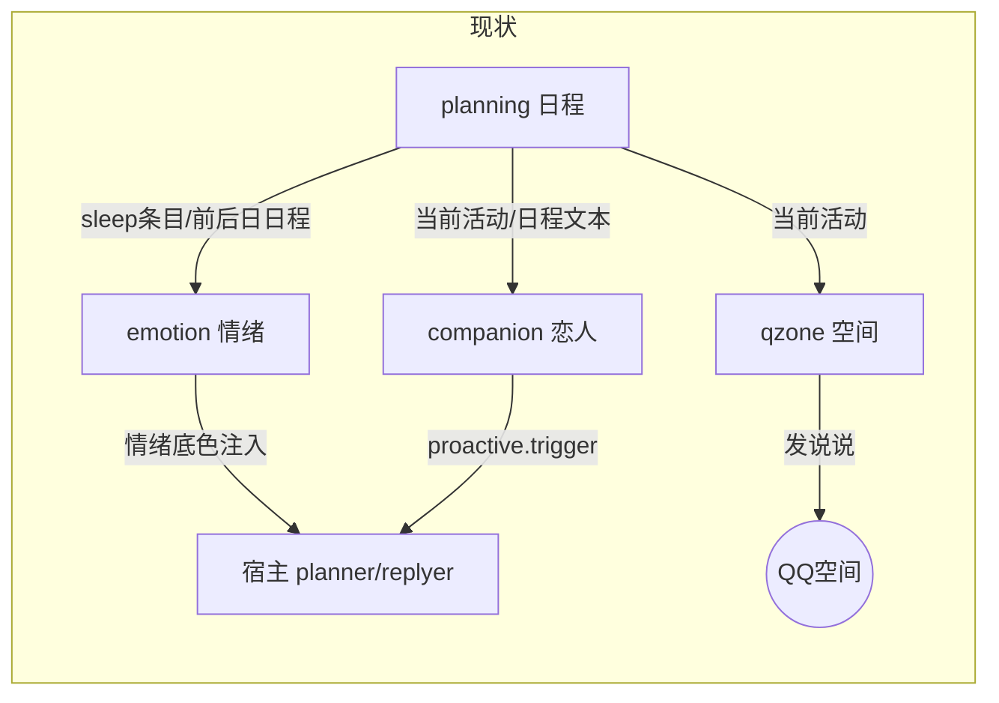
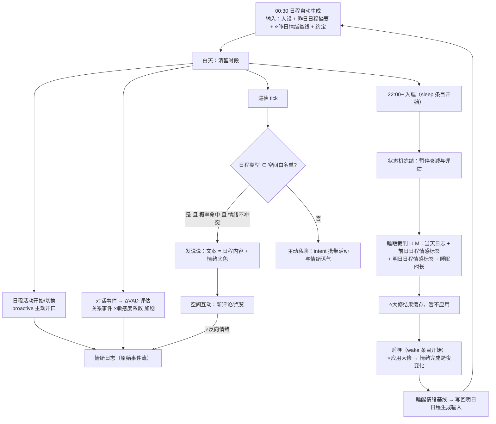

# 模块联动设计（SYNERGY.md）

> 状态：**现状文档**（含流程图；事件总线已于 M0 落地，见 §3.5：`core/event_bus.py` + 全渠道打扰预算；§2~§4 其余联动点仍为规划，按 MAINTENANCE_PLAN 路线图分期落地）。
> ⚠️ 2026-10-03 起：分路线图已被 **[MAINTENANCE_PLAN_10.25.md](MAINTENANCE_PLAN_10.25.md)** 取代（P1~P5 → M0~M6），并新增好感度 v2 重设计与模块相互影响矩阵；本文 §1~§4 的现状与联动点详设继续有效（旧 `MAINTENANCE_PLAN.md` 为 v1.2 快照，已废弃）。
> 四个业务模块：planning（日程）/ companion（恋人·将扩展为关系系统）/ qzone（空间）/ emotion（情绪）。
> 目标：把四个模块从"各自独立运行、少数点对点引用"升级为**昼夜节律闭环**——日程塑造情绪，情绪反塑日程，关系放大波动，空间是情绪的出口。

---

## 1. 现状联动（已实现的部分）

| 数据流 | 路径 | 说明 |
|---|---|---|
| planning → companion | `ScheduleQuery.find_current_activity / format_day_summary` | 恋人注入与巡检读取当前活动 |
| planning → qzone | `ScheduleQuery.find_current_activity` + 日程文案 | 空间按日程活动发说说（`require_activity` + 概率） |
| planning → emotion | sleep 条目触发大修；前后日日程、`schedule.custom_prompt` 作裁判输入 | 睡眠大修已消费日程 |
| emotion → 宿主 | replyer 模型请求系统条目（planner/replyer 双通道） | 情绪底色注入 |
| companion → emotion | （无） | **联动空白点 1** |
| emotion → planning | （无） | **联动空白点 2** |
| qzone → emotion | （无） | **联动空白点 3** |



---

## 2. 目标闭环总览（一天的时间轴）



⭐ = 本规划新增的联动点。核心变化：**情绪的跨夜变化从"入睡瞬间应用"改为"睡醒后应用"**（入睡即冻结，醒来才结算），与大模型日程形成昼夜闭环。

---

## 3. 联动点详设

### 3.1 前一天日程 → 睡眠大修幅度（用户需求 ①）

当前睡眠裁判只把日程当"文本参考"。规划为**日程情感预期标签**：

- 日程生成时（planning 的 schema_builder），每个条目增加可选字段：

```json
{"name": "期末考试", "time_slot": "09:00", "goal_type": "study",
 "emotional_tone": {"valence": -0.4, "arousal": 0.7, "dominance": -0.5}}
```

  由生成 LLM 按 `emotional_tone` 枚举（沉重/紧张/期待/轻松/平淡…）给出，代码校验区间后落入 `parameters`。

- 睡眠大修输入新增两组数值：
  - **前一日日程情感残差** `R_yesterday`：前一日各条目 `emotional_tone` 按"释怀/反刍"系数加权求和（人格过滤：高神经质 → 反刍权重更大）；
  - **次日日程情感预期** `E_tomorrow`：明日条目同理（考试 → V↓A↑D↓）。
- 大修公式升级（现有：`锚点 + (当前−锚点)×恢复系数 + ΔVAD裁判`）：

```
raw = 锚点
    + (当前 − 锚点) × 恢复系数(睡眠时长倒U)
    + ΔVAD裁判
    + R_yesterday × w1        # 前日日程越沉重，残留越多、恢复越慢
    + E_tomorrow  × w2        # 明日越有压力，睡醒越焦虑
```

- **幅度联动**（即"前一天日程影响变化幅度"）：定义 `schedule_emotion_weight = |R_yesterday| 的归一化`，把裁判允许的 ΔVAD 限幅从固定 ±0.8 改为 `±(0.4 + 0.4 × schedule_emotion_weight)`——前一天生活越跌宕，睡眠后的情绪摆动幅度越大；平淡的一天睡醒几乎回到锚点。

### 3.2 情绪睡醒后再变化 → 反塑新一天日程（用户需求 ②）

- **睡醒应用**：状态机在 sleep 条目开始后即冻结（暂停 `apply_daily_decay` 与 ΔVAD 评估，事件仍入队但不结算）；大修计算在入睡后完成并**缓存**；当 `find_current_activity` 离开 sleep 类型的那一刻（醒来的第一个活动开始），才应用缓存结果并解除冻结。
- **情绪 → 次日日程**（闭环关键）：
  - `PromptBuilder.build_schedule_prompt` 新增 `emotion_context` 槽位（与 yesterday_context 同级），内容 = 睡醒 VAD 的低分辨率描述 + 情绪标签 + 引导约束；
  - 约束示例：情绪低落（V<-0.3）→ "今天安排更多 rest/entertainment/social_maintenance 类活动，学习强度调低"；兴奋（A>0.5）→ "可安排运动与社交"；焦虑 → "保留一段 relaxation，避免连续高压条目"；
  - 同时把"长期状态"（custom_prompt）与情绪叠加：期末周 + 情绪低迷 → 日程"被压力笼罩但穿插自我调节"。
- 配置：`schedule.emotion_influence`（0~1，情绪对日程的影响强度，0=关闭）。

### 3.3 关系系统：companion 扩展，目标行为加剧情绪（用户需求 ③）

companion 的 `target_qq` 升级为**关系档案**（relation profile）：

```toml
[relation]
enabled = true
type = "lover"            # lover 恋人 / best_friend 挚友 / keeper 维护者 / family 家人 / custom
```

- **关系敏感度系数** `sensitivity`：该用户引发的情绪事件 ΔVAD 乘数。默认表（可按关系覆盖）：

  | 关系 | 敏感度 | 说明 |
  |---|---|---|
  | lover | 1.5 | 恋人的一句话情绪权重最高 |
  | best_friend | 1.2 | 挚友 |
  | keeper | 1.0 | 维护者（照常） |
  | stranger | 0.4 | 陌生人几乎不影响情绪 |

- **关系事件 → 情绪**：`chat.receive.after_process` 中识别目标用户消息的语义事件（复用 ΔVAD 评估请求，事件描述标注"来自恋人/挚友"），`record_event` 前乘 sensitivity；**长期沉默**（patrol 的 miss 检测）本身作为负面事件写入情绪日志（如 `ΔV=-0.15, ΔA=+0.05`）；
- **情绪 → companion**：miss 阈值、早安晚安措辞、好感度后缀已有；新增"情绪语气"叠加（情绪底色注入已覆盖 replyer，proactive 的 intent 文本追加情绪提示）；
- **关系深度动态化**：好感度档位（affection）随关系事件累计演化，反过来微调 sensitivity（越亲密放大越强），形成关系—情绪螺旋。

### 3.4 巡检 × 日程类型 × 空间发送（用户需求 ④）

在现有 qzone 循环基础上细化：

- **日程类型白名单**：`qzone.post_goal_types = ["meal", "exercise", "entertainment", "rest", "social_maintenance", "free_time"]`——当前活动类型在白名单内才进入概率判定（study/work 默认不发，避免"考试也发动态"的违和）；
- **文案深度引用日程**：生成 prompt 从"正在：晚餐 [18:30-19:30]"升级为携带条目 `description` 原文与 `emotional_tone`，让动态内容与具体活动对应（"今天跑步配了新歌单，感觉能跑十公里"而不是泛泛的"在运动"）；
- **情绪一致性**：情绪标签作为文案 prompt 的一部分（沮丧时发的动态也是沮丧基调）；可配置 `qzone.emotion_filter`：极端负面情绪（V<-0.6）默认不发（避免低落时强行营业），或按人设决定；
- **巡检联动**：patrol 的 tick 与 qzone 的 tick 共享"本次巡检是否已发过空间/私聊"的额度互斥（同一天空间+私聊合计不过载）。

### 3.5 联动基础设施：模块事件总线（我补充的想法）

目前模块互访靠 `plugin._planning` 等直接引用，新联动会越来越多。建议加一个进程内轻量事件总线 `core/event_bus.py`（约 100 行）：

- `EventBus.publish(event_name, payload)` / `subscribe(event_name, handler)`，服务束在 start 时注册订阅，stop 注销；
- 标准事件表（首批）：

| 事件 | 发布方 | 订阅方（规划） |
|---|---|---|
| `schedule.generated` | planning | emotion（缓存明日情感预期）、qzone |
| `schedule.activity_started` | planning proactive | companion（主动开口）、qzone（类型白名单判定） |
| `schedule.sleep_started` / `schedule.woke_up` | emotion 或 proactive | emotion（冻结/应用大修） |
| `emotion.overhauled` | emotion | planning（次日生成输入）、日志 |
| `emotion.updated` | emotion | （调试日志） |
| `relation.event` | companion | emotion（×敏感度）、日志 |
| `qzone.posted` / `qzone.comment_received` | qzone | emotion（互动情绪）、日志 |

- 好处：新模块只要订阅事件即可参与联动（"包括后续添加的新模块"）；所有事件顺带落 decision_logs，可回放调参。

### 3.6 其他补充想法

1. **睡眠质量事件源**：睡眠裁判输入加"今日约定兑现情况"（planning 的 pending_commitment 当日消费结果）——有未兑现约定 → 恢复系数打折（`×0.9`），裁判 prompt 里注明原因；
2. **节假日情绪基线**：holiday_service 判定为假期日 → 情绪锚点 V 临时上移 +0.1、日程模板走周末分支，形成"假期真的更开心"；
3. **情绪—表达一致性审计**（可选，成本敏感）：极端情绪下（|V|>0.6）对即将发出的空间动态做一次小模型一致性检查，矛盾则改写或放弃；
4. **连续低迷软约束**：连续 3 天 V 日均 < -0.5 → 强制次日日程插入一次 social_maintenance/free_time，并在注入文本提示"最近有点低落"（防止彻底抑郁，呼应原设计文档 §十二.3）；
5. **回放调参**：事件总线全量落盘后，可以离线重放一天的数据流，观察参数（敏感度、权重 w1/w2、衰减率）对闭环的影响。

---

## 4. 持久化数据流（谁读谁写）

| 存储 | 写入方 | 读取方 |
|---|---|---|
| `schedule.db`（日程/目标/约定） | planning 生成/应用 | companion（活动）、qzone（活动）、emotion（sleep 条目+前后日）、planning 注入 |
| `emotion_state.json`（VAD/日志/大修缓存） | emotion | emotion（睡眠循环）、planning 生成（P2 后）、注入 |
| `emotion_config.json`（锚点/偏移/乘数） | emotion 初始化/微调 | emotion 状态机 |
| `affection_memory.json`（好感度/habits） | companion | companion、（P4 后）emotion 关系敏感度 |
| `qzone_state.json`（说说额度/评论基线） | qzone | qzone |
| `decision_logs/*.jsonl` | 各模块（+事件总线） | /life diag、调参回放 |

---

## 5. 分期实现路线图

| 期 | 内容 | 主要落点 | 依赖 |
|---|---|---|---|
| P1 | 事件总线 + 日程情感标签（schema 加 `emotional_tone`，落 parameters） | `core/event_bus.py`、`planning/generator/schema_builder.py`、`prompt_builder.py` | 无 |
| P2 | 睡醒应用大修（冻结/解冻）+ 情绪→次日日程（`emotion_context` 槽 + 约束 + `schedule.emotion_influence`） | `emotion/service.py`、`planning/generator/prompt_builder.py`、`planning/schedule_generator.py` | P1 |
| P3 | 睡眠大修 v2（前后日情感残差/预期、动态限幅、约定兑现输入） | `emotion/service.py`、`referee.py`、`state_machine.py` | P1 |
| P4 | 关系系统（relation 配置段、敏感度表、关系事件→情绪、长期沉默事件化） | `companion/config.py`、`components.py`、`patrol.py` | P1 |
| P5 | 空间联动（goal_type 白名单、日程描述文案、情绪一致性过滤、互动→情绪、额度互斥） | `qzone/config.py`、`service.py` | P1、P2（情绪标签） |

## 6. 风险与防崩坏

- **闭环震荡**：情绪影响日程、日程又影响情绪，需限制单次日程对情绪的影响上限（`emotional_tone` 裁剪 ±0.5），且恢复系数恒 ≥0.3 保证向锚点收敛；
- **成本**：每回复一次评估 + 每晚一次裁判 + 按需文案，均为小预算请求；事件总线本身零 LLM 成本；
- **可观测性**：所有联动事件强制落 decision_logs（含 payload 摘要），/cateye_test_life diag 可查跨模块因果链。
